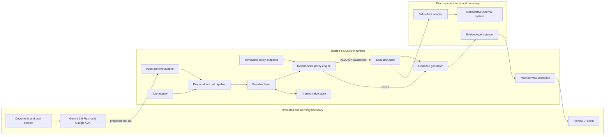

# TIDEMARK System Architecture

**Version:** 1.0
**Status:** implementation baseline
**Date:** 2026-08-06

## 1. Purpose and scope

This document defines the bounded architecture for the definitive TIDEMARK product. It describes responsibilities, data movement, and trust boundaries without selecting incidental implementation details. The architecture implements the [Product Boundary](../specs/PRODUCT_BOUNDARY_v1.0.md) and the invariants in [Implementation Principles](../specs/IMPLEMENTATION_PRINCIPLES_v1.0.md). Competition-mandated integration requires Gemini 3.6 Flash through Google ADK, Google Cloud deployment proof, and €0 personal out-of-pocket spend.

The architecture protects a narrow transition: an agent proposes a tool call, the trusted runtime prepares and authorizes it, and only an allowed prepared call may reach a side-effecting execution adapter.

## 2. Architectural boundary

TIDEMARK contains the runtime registry, policy installation and evaluation, trusted value resolution, prepared-call pipeline, execution gate, and evidence generation. It exposes adapter interfaces to an agent runtime, trusted data stores, side-effecting systems, evidence storage, and a read-only review UI.

TIDEMARK does not own model inference, document trust, business identity, user permissions, cloud identity, or the external system that ultimately performs the side effect.

## 3. Logical architecture

The diagram shows logical authority, not deployment topology. Components may initially share one process as long as their interfaces and ownership remain explicit.

## 4. Major runtime components

### 4.1 Agent runtime adapter

The adapter receives the agent framework’s pending tool-call event and translates it into a framework-neutral call proposal with tool identity, arguments, invocation correlation, and adapter metadata. It invokes TIDEMARK before the framework executes the tool.

The adapter must support a deterministic veto that prevents the tool body from running. Framework objects are not authoritative policy data. The hackathon adapter targets Google ADK to satisfy the selected Google Agent Framework requirement and because that callback path was validated in the spike; the core must not depend on ADK types.

The live model path is fixed to Gemini 3.6 Flash. The adapter may use Gemini API or Vertex AI only after the pre-integration record verifies the exact model identifier, supported path, quota, billing/funding source, and €0 personal-spend exposure. It must not silently change model, provider path, or billing source. Deterministic offline operation is an explicitly labeled development/demo/evidence fallback and is not live-model compliance.

### 4.2 Tool registry

The registry is the runtime-owned inventory of executable tools. Each entry binds:

- a stable tool identifier;
- canonical signature metadata;
- a versioned tool contract;
- protected-role metadata;
- effect and reversibility classification;
- the approved execution adapter;
- evidence masking rules.

Registration is complete or refused. A tool may not execute through TIDEMARK with missing, partial, or inconsistent metadata. The model’s advertised schema is not the source of registry truth.

### 4.3 Policy snapshot installer

The installer accepts only supported authoring data, validates exact forms and registry coverage, canonicalizes data into fresh internal values, and publishes a sealed policy snapshot. Evaluation reads only that snapshot.

The snapshot contains inert policy data: identifiers, enums, exact supported scalar parameters, ordered argument roles, and registry references. It contains no caller-supplied executable constraint objects or mutable authoring structures.

### 4.4 Resolver layer

The resolver is the only component that turns an opaque protected reference into a protected value. It validates:

- reference existence and format;
- expected value kind;
- invocation or session binding;
- parent-record binding;
- expiry and lifecycle state;
- single-use or replay state where required;
- trusted store provenance.

The resolver returns a runtime-only resolved value and resolution facts. It never exposes the full protected value to the model or UI projection. Minting and trusted lookup are internal services, not general model tools.

### 4.5 Trusted value store

The trusted store holds protected values, opaque-reference records, binding metadata, and lifecycle state. Only approved runtime components may mint or update these records. The initial implementation may use a local store behind an interface. Distributed transactional semantics are deferred until the cloud milestone.

### 4.6 Prepared tool call pipeline

The pipeline is the only path from a raw call proposal to execution. Its ordered stages are:

1. **Intake:** create a correlation identifier and capture immutable call context.
2. **Registry lookup:** locate the tool entry and policy snapshot; refuse unknown or incomplete registrations.
3. **Structural validation:** verify signature and contract parity, required arguments, role definitions, and supported canonical types.
4. **Canonicalization:** convert approved unprotected inputs into stable domain values without invoking caller-defined behavior.
5. **Resolution:** resolve protected references and capture binding and lifecycle facts.
6. **Policy evaluation:** apply deterministic provenance, representation, binding, replay, and value-bound rules in documented order.
7. **Decision sealing:** emit DENY or create an immutable prepared tool call associated with an ALLOW decision and policy version.
8. **Execution gating:** provide only the sealed prepared call to the registered execution adapter.
9. **Outcome capture:** record execution completion or failure and apply lifecycle consumption rules.

A raw proposal, partially resolved call, or mutable argument map is never an execution input.

### 4.7 Deterministic policy engine

The engine consumes canonical call data, trusted resolution facts, the immutable snapshot, and call context. It has no model dependency and no authority to fetch untrusted data.

The engine evaluates structural integrity before policy-specific bounds. Stable rule identifiers distinguish contract failure, protected-representation failure, reference failure, binding failure, value-bound failure, replay, and other supported outcomes. Exact identifiers will be specified in the first implementation milestone and thereafter treated as versioned evidence contracts.

Unknown state, unsupported policy, failed resolution, or inconsistent metadata produces refusal or DENY. No error path defaults to ALLOW.

### 4.8 Execution gate and adapters

The execution gate accepts only an immutable prepared tool call whose ALLOW decision, policy version, tool registration, and correlation are intact. It ensures the selected adapter matches the registered tool and that the call has not already been consumed under the workflow’s replay rules.

Side-effect adapters translate the domain call into an external operation. They do not reclassify argument trust or bypass policy. The authoritative external system remains responsible for its own authentication, business validation, idempotency, and transaction guarantees.

### 4.9 Evidence generator

Evidence generation is part of the runtime path. It records structured events for:

- call intake;
- preparation refusal;
- DENY and its rule/stage;
- ALLOW and prepared-call identity;
- execution start, completion, failure, or replay rejection;
- policy, registry, adapter, and evidence-schema versions.

Records contain correlation identifiers and masked projections, not protected values. Evidence for a denied call must show that no execution-start event or authoritative side effect exists. The bounded reference workflow also uses an explicit execution marker or authoritative store assertion.

### 4.10 Masked view projection

The view projection converts evidence records into a read-only, single-screen explanation. It can show tool name, time, decision, rule, argument roles, provenance classes, reference/binding status, and execution outcome. It must not expose full protected values, internal credentials, raw secrets, or mutable policy controls.

## 5. Trust boundaries

### Boundary A: model and content to runtime

Everything authored by the model, user, document, or conversation is untrusted. Tool name and arguments are proposals. The runtime adapter normalizes transport data but does not grant trust.

### Boundary B: authoring input to policy snapshot

Configuration and contract authoring data are not authoritative until validated and canonicalized. Caller-created internal types, subclasses, executable objects, unsupported nested parameters, or incomplete registry metadata are rejected.

### Boundary C: opaque reference to protected value

Only the resolver crosses this boundary. Possession or shape of a reference is insufficient; trusted store lookup and binding checks establish validity.

### Boundary D: authorization to execution

Only an ALLOW-associated prepared tool call crosses into the execution gate. This is the principal enforcement boundary. Agent-framework defaults, direct tool invocation, or UI actions must not route around it.

### Boundary E: evidence to UI

The UI consumes masked projections. It cannot mutate policy, mint references, authorize calls, retry execution, or access protected values in v1.0.

## 6. Policy engine invariants

The implementation must preserve these invariants:

1. Every executable tool has complete, trusted registry metadata.
2. Every evaluated policy is a named immutable snapshot.
3. Snapshot construction retains no caller-owned mutable or executable policy state.
4. Constraint behavior is resolved only from the trusted runtime registry.
5. Protected roles require resolved references; raw values cannot satisfy them.
6. Contract and signature integrity are checked before role-specific authorization.
7. All arguments are checked before a prepared call is sealed.
8. Any unknown or malformed state fails closed.
9. The policy engine has no side-effect capability.
10. DENY cannot reach the execution adapter.

## 7. UI boundary

The v1.0 UI is an evidence reader. It may filter or select existing records but has no write path to contracts, trusted records, references, decisions, or external tools. Any future action such as approval, retry, override, policy editing, or reference minting is outside this architecture and requires a new product-boundary version.

The UI must be safe to display during the hackathon: protected destinations remain masked, raw fixtures are not rendered by default, and the evidence graphic is clearly identified as product runtime output rather than proof of production readiness.

## 8. Cloud boundary

The core runtime is local-first and cloud-neutral. The hackathon release must nevertheless deploy at least one bounded backend component to a Google Cloud infrastructure service and capture proof of that deployment. Cloud services provide deployment, and may provide trusted storage, evidence persistence, or external execution connectivity, only through explicit adapters. Introducing them does not change policy semantics. The deployed architecture must remain operable with €0 personal out-of-pocket spend and may consume only verified non-personal funding under bounded cost controls.

Before a cloud milestone begins, the repository must define:

- service identities and least-privilege access;
- authoritative writer ownership for trusted records;
- transactional consume-and-decide and retry semantics;
- idempotency across execution and evidence persistence;
- secret management and log redaction;
- retention, deletion, and access rules for evidence;
- failure behavior for unavailable stores or partial external outcomes.
- verified billing and funding source, credit/free-tier coverage, balance/quota, expiry, and overage behavior;
- a budget alert configured before deployment, bounded request volume, a maximum instance count, scale-to-zero where supported, and minimum viable CPU/memory;
- daily spend checks and a tested shutdown/rollback procedure.

No cloud component is part of the initial core milestone. The later Google Cloud deployment milestone is mandatory for hackathon submission and requires explicit human approval before cloud infrastructure is introduced. A public endpoint and continuous availability remain optional. An architecture that depends on recurring paid services or cannot bound consumption to €0 personal spend is unacceptable.

## 9. Failure handling

- Invalid startup configuration prevents the affected registry from becoming executable.
- Invalid call structure produces refusal or a contract-integrity DENY.
- Failed reference resolution produces DENY and no execution.
- Evidence persistence failure before execution fails closed for the reference workflow unless a later specification defines a safe journal.
- External execution failure is recorded as an execution outcome; it must not be rewritten as a policy DENY.
- Ambiguous timeout or retry state is not automatically replayed. Recovery behavior belongs to the later transaction specification.
- Gemini 3.6 Flash, verified quota, or zero-cost access-path unavailability stops live requests and records a blocker; it never triggers silent model/path substitution or personal spend.
- The offline path remains available for development fallback, demo resilience, and evidence fallback, but it cannot satisfy the required live Gemini or Google Cloud proof.

## 10. Evolution rules

Architecture changes must preserve the separation among agent adapter, policy core, resolver, execution adapter, evidence, UI, and cloud infrastructure. Adding identity, policy administration, declassification, multiple side-effecting workflows, or distributed execution semantics requires a new architecture version and product-boundary review.

