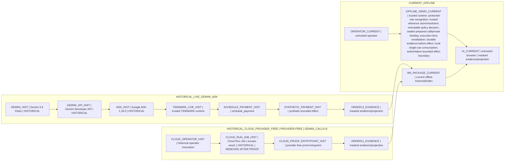

# TIDEMARK Variant C W6 Deployment Architecture

**Status:** W6 communication surface
**Scope:** Evidence traversal, not a production deployment specification

This diagram keeps three provenance and time regions structurally separate: `CURRENT_OFFLINE`, `HISTORICAL_LIVE_GEMINI_ADK`, and `HISTORICAL_CLOUD_PROVIDER_FREE`. `HISTORICAL_OFFLINE_GOOGLE_ADK` remains a distinct provenance class for the Order 11 evidence indexed by the W6 package; it is not presented as live Gemini evidence here.

The Order 12 chain records the historical live Gemini Developer API and Google ADK path. The independent Order 21 chain records a provider-free Cloud Run Job proof with `GEMINI_CALLS=0`; the resource was `REMOVED AFTER PROOF`. No directed edge connects the Gemini/API/ADK historical chain to the Cloud Run Job.

The diagram creates no evidence fact and grants no authority. It does not describe current Gemini execution, a present Cloud Run resource, a public endpoint, cloud persistence, or a production deployment specification.
