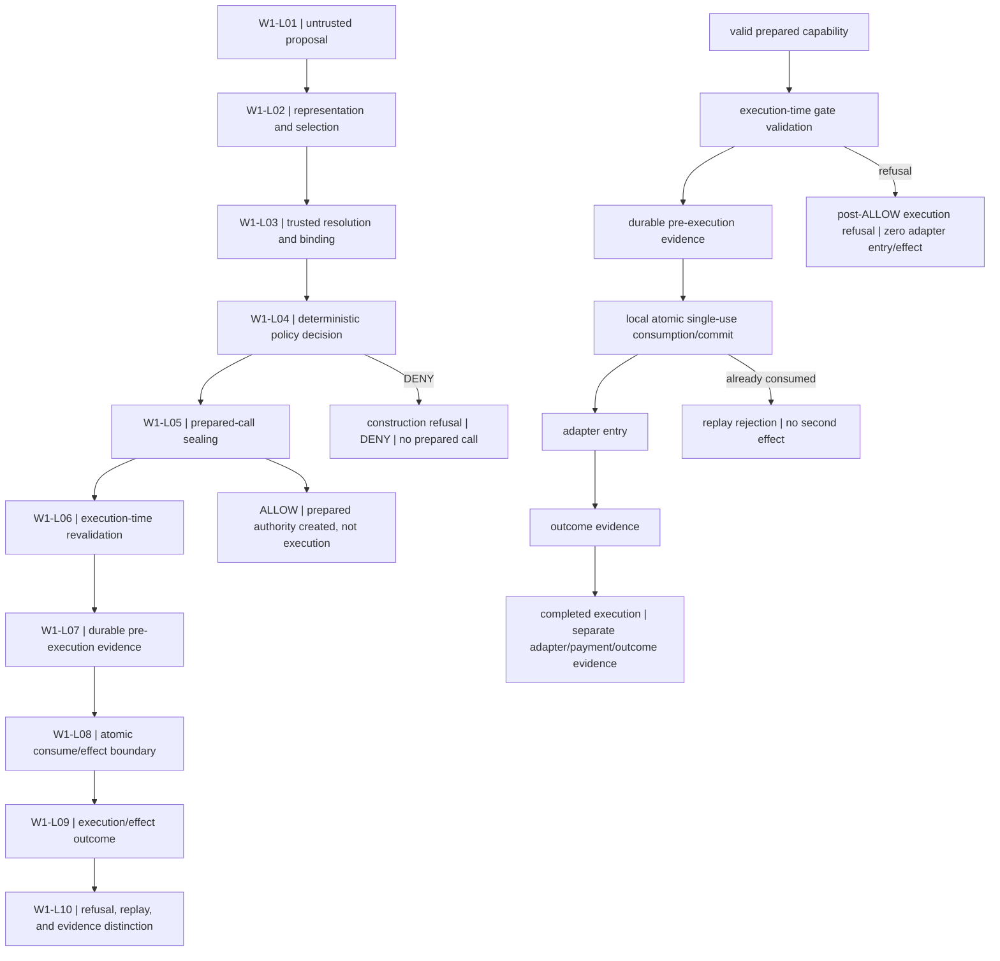

# TIDEMARK Variant C W6 Prepared-Call Lifecycle

**Status:** W6 communication surface
**Scope:** Existing W1 ten-stage lifecycle

The diagram restates the committed W1 lifecycle without adding a second revalidation or stronger transaction semantics.

The authoritative transaction sequence is the single chain from `valid prepared capability` through `outcome evidence`. W1-L01 through W1-L10 preserve proposal, selection, trusted binding, deterministic decision, sealing, one execution-time validation, evidence-before-effect, the local atomic boundary, outcome, and refusal/replay distinctions.

The limits are explicit: `ALLOW != EXECUTED`, `LOCAL_AT_MOST_ONCE != EXTERNAL_EXACTLY_ONCE`, and `TEST_INTERLEAVING != DISTRIBUTED_EXACTLY_ONCE_PROOF`. This lifecycle does not assert a distributed transaction, scheduler fairness, or an external-effect exactly-once guarantee. It creates no evidence fact and grants no authority.
