# TIDEMARK Variant C W6 Trust-Boundary Architecture

**Status:** W6 communication surface
**Scope:** Bounded trust and information-flow view

The diagram separates untrusted proposal and browser surfaces from trusted/private runtime material. It describes selection of trusted authority, never model supply of protected authority: `SELECTION_NOT_SUPPLY` and `NO_MODEL_SUPPLIED_PROTECTED_ARGUMENTS`.

```mermaid
flowchart LR
    UNTRUSTED_PROPOSAL["untrusted model | prompts/documents/business content | raw tool arguments"]
    REPRESENTATION_CHECK["protected-role representation check | SELECTION_NOT_SUPPLY | NO_MODEL_SUPPLIED_PROTECTED_ARGUMENTS"]
    TRUSTED_REFERENCE["reference issuer/store/resolver | opaque selection"]
    POLICY["trusted runtime registry/policy snapshot | policy engine"]
    PREPARED_CALL["prepared-call/private-binding coordinator"]
    EXECUTION_GATE["execution gate | execution-time revalidation"]
    EVIDENCE["evidence sink/reconciler/projector | durable evidence before effect"]
    LOCAL_CONSUMPTION["local atomic consumption"]
    SYNTHETIC_ADAPTER["credentialed synthetic adapter"]
    PAYMENT_STORE["authoritative payment store"]
    PUBLIC_PROJECTION["masked projection"]
    UNTRUSTED_BROWSER["untrusted browser"]
    REFUSAL["construction refusal or DENY | no prepared authority"]

    UNTRUSTED_PROPOSAL --> REPRESENTATION_CHECK
    REPRESENTATION_CHECK --> TRUSTED_REFERENCE
    TRUSTED_REFERENCE --> POLICY
    POLICY -->|"ALLOW != EXECUTED"| PREPARED_CALL
    POLICY -->|"DENY"| REFUSAL
    PREPARED_CALL --> EXECUTION_GATE
    EXECUTION_GATE --> EVIDENCE
    EVIDENCE --> LOCAL_CONSUMPTION
    LOCAL_CONSUMPTION --> SYNTHETIC_ADAPTER
    SYNTHETIC_ADAPTER --> PAYMENT_STORE
    PAYMENT_STORE --> EVIDENCE
    EVIDENCE --> PUBLIC_PROJECTION
    PUBLIC_PROJECTION --> UNTRUSTED_BROWSER
```

`ATTEMPTED_ACTION != AUTHORIZATION_DECISION != OBSERVED_SIDE_EFFECT`. An ALLOW decision can create bounded prepared authority, but it does not establish adapter entry or an observed effect.

The private side relies on `host/interpreter`, `approved configuration`, `trusted functions`, `credentials`, and the `infrastructure boundary`; these are assumptions, not W6-proven assets. The browser receives only a masked projection and no trusted/private runtime material.

This view does not claim general prompt-injection prevention, production trust, external attestation, distributed exactly-once behavior, or external-effect exactly-once behavior. It creates no evidence fact and grants no authority.
